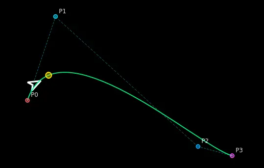

# Mouse Shaper

Mouse Shaper is an X11 cursor overlay that draws an SVG craft following the
mouse pointer along a smooth Bezier path. Craft appearance, physics, pointer
markers, and input-triggered craft changes are configured in `config.yaml`.



## Requirements

- Linux desktop running an X11/Xorg session (Wayland is not supported)
- [Pixi](https://pixi.sh/)

## Run

From the repository root:

```bash
pixi run mouse
```

The application loads `config.yaml` and the SVG assets from `svgs/`. Press
either Control key to show or hide the craft overlay. Press either Shift key
to show or hide the Bezier debug overlay.

## Configuration

`config.yaml` has three main sections:

- `application`: global motion and update settings.
- `craft`: named craft definitions, each with SVG, cursor, fade, physics, and
  event-subscription settings.
- `physics_profile`: reusable visual and movement profiles.

`application.default_craft` chooses the craft used at startup.

### Crafts

Each craft selects a chaser SVG from `svgs/` without its `.svg` extension:

```yaml
craft:
  spaceship:
    svg:
      chaser: spaceship
      cursor: 0
    physics_profile: profile1
    fade:
      distance_beg: 1.0
      distance_end: 80.0
      opacity_min: 0.0
    subscribed_events: [RunSwitch]
```

`svg.cursor` accepts:

- `0` to keep the system cursor visible.
- A positive integer to show the built-in green pointer marker at that size.
- An SVG filename such as `crosshair.svg` to replace the pointer with
  `svgs/crosshair.svg`.

`subscribed_events` lists the named `event_profile` bindings that can start
while this craft is active. The craft subscribed at the initial `down` event
remains subscribed through the matching `hold` and `up` events, even if an
event changes the displayed craft.

### Physics profiles

Crafts use `physics_profile` by name. Profiles contain:

- `visual`: craft size, heading offset, speed/acceleration response, maximum
  scale and stretch, and visual smoothing.
- `linear_motion`: speed limits and drag.
- `bezier`: route curvature, handle sizes, route sampling, and acceleration.

Event actions can temporarily select a different profile. When
`physics_restore: true` is set on a subscribed `down` action, the physics
profile active before the press is restored after the matching `up` action.

### Event profiles

An event profile binds one keyboard key or mouse button to ordered actions:

```yaml
event_profile:
  - name: RunSwitch
    key: Button1
    events:
      - type: down
        craft: ufo
        cursor: 0
        physics_profile: profile1
        physics_restore: true
      - type: hold
        every: 100
        craft: ufo
        cursor: 0
        physics_profile: profile1
        physics_restore: true
      - type: hold
        every: 100
        every_offset: 50
        craft: spaceship
        cursor: 0
        physics_profile: profile1
        physics_restore: true
      - type: up
        craft: spaceship
        cursor: 0
        physics_profile: profile1
        physics_restore: true
```

`key` accepts an X11 keysym (for example `space`, `Shift_L`, or `a`) or a
mouse button (`Button1`, `Button2`, and so on). Actions run in the listed
order:

1. `down` runs once when the key or button is pressed.
2. `hold` runs every `every` update ticks while it remains pressed.
3. `up` runs once when it is released.

For a repeating `hold`, `every_offset` shifts its cadence. The default is
`0`; it must be an integer from `0` through `every - 1`. In the example, the
UFO activates at ticks 100, 200, and so on, while the spaceship activates at
ticks 50, 150, and so on.

Each action must specify `craft`, `cursor`, `physics_profile`, and
`physics_restore`. Events are validated at startup; unknown crafts, physics
profiles, subscriptions, and invalid hold intervals are reported as errors.

## Customization

### Add a craft

1. Add an SVG to `svgs/`. The overlay currently renders the craft within
   `viewBox="-10 -2 20 24"`, centered with its forward direction upward.
2. Add a matching entry under `craft`, setting `svg.chaser` to the SVG
   filename without `.svg`.
3. Select an existing `physics_profile`, configure fade behavior, and add
   any subscribed event names.
4. Set `application.default_craft` to use it at launch, or select it from an
   event action.

### Add a custom cursor

Place the cursor SVG in `svgs/`, then set `cursor` in a craft or event action
to its filename, for example `cursor: crosshair.svg`.

### Add an input behavior

1. Add a named `event_profile` group with an X11 key or `ButtonN`.
2. Add the event name to `subscribed_events` for each craft allowed to start
   that behavior.
3. Add `down`, optional repeating `hold`, and `up` actions to select the
   required craft, cursor, and physics profile.
